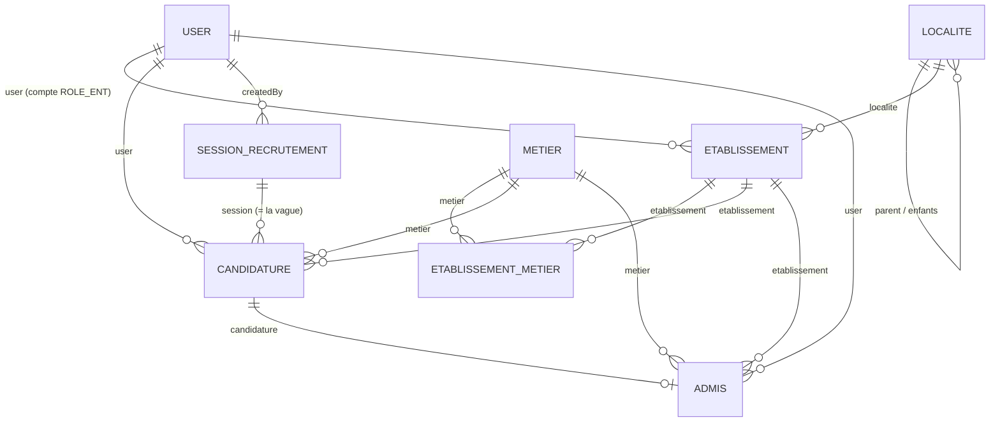

# CLAUDE.md — Adaptation du projet DAIKIN vers PACTE (v3)

Instructions strictes pour l'agent IA chargé de modifier le projet Symfony existant. Lire l'intégralité du document avant toute modification. Objectif : adapter l'application de recrutement existante à PACTE en conservant le processus, les entités et les relations autant que possible.

**Principe directeur : appliquer uniquement les modifications nécessaires. Ne pas ajouter de champs, de relations ni de règles métier qui ne répondent pas à un besoin réel.**

Sources de référence : le code de l'archive ; `vf-COMMUNIQUE DE RECRUTEMENT PROJET PACTE.docx` (racine) ; les décisions explicites de ce document. **En cas de contradiction, ce document prime sur toute proposition antérieure.**

---

## 0. Règles absolues

1. **Analyser avant de modifier** : parcourir entités, relations Doctrine, contrôleurs, formulaires, services, templates, routes, configuration et requêtes. Ne pas déduire le fonctionnement d'un nom de fichier.
2. **Conserver** le processus de recrutement, les noms d'entités, les relations, les contrôleurs, les routes (`name:`) et l'arborescence des templates. **Pas de nouvelle entité « Vague »** : une vague est une `SessionRecrutement`.
3. **Un seul renommage autorisé** (propriété, colonne, getters/setters, formulaires, contrôleurs, exports, templates) : `Candidature::$vague` → `Candidature::$creneauEntretien` (colonne `creneau_entretien`). Il est **déjà appliqué** dans `entites/Candidature.php` fourni avec ce document ; il reste à le propager dans le reste du code (§6). **Les champs de pièces gardent leurs noms de stockage** `fpiece`, `fniveau`, `fautre` : seuls leurs libellés changent (D8).
4. Les trois profils d'éligibilité (§1.4) sont des conditions **informatives** expliquées sur la page publique ; leur conformité documentaire est vérifiée à la main à l'étude de dossier. Le candidat ne sélectionne aucun profil dans le formulaire.
5. `noteEpreuveEcrite` et `noteEpreuveOrale` : colonnes numériques nullables **en base uniquement** (déjà dans `entites/Candidature.php`). Pas dans les formulaires, pas affichées, pas utilisées. Ne pas toucher au calcul sur `note1..note13`, ne pas inventer de pondération.
6. **`EtablissementMetier` reste inchangé** : la configuration établissement–métier et `nbrplace` sont permanentes et réutilisables d'une session à l'autre ; `estActif` active/masque une association.
7. **`nbrplace` est strictement informatif.** Aucun quota, plafonnement, contrôle de disponibilité ni blocage d'inscription lié à cette valeur ; ne pas la comparer au nombre d'admis. Les places affichées sont lues en base.
8. **Aucun envoi d'e-mail ou de SMS** n'est demandé : ne pas configurer ni déclencher de flux ; ne pas modifier `MailNotifier` / `SmsNotifier` (ils ne contiennent aucune mention de marque et ne sont injectés que dans `UserController`). Mettre à jour le générateur PDF et les documents réellement utilisés.
9. **Ne rien inventer** : développé de PACTE, développé de « MENAET » / « CAB-MDET », coordonnées, infoline, numéro du communiqué, nom complet du projet, localité de l'établissement d'Énergie Renouvelable, partenaires. Utiliser `null` ou « À COMPLÉTER » et consigner dans le rapport.
10. **Logos non fournis** : ne pas en dessiner ni en télécharger. Prévoir les chemins `image/pacte/logo-pacte.png` et `image/pacte/logo-ministere.png` avec un **rendu de secours en texte « PACTE »** si les fichiers sont absents.
11. **Pas de secrets** : ne pas lire, afficher ni committer `.env.local`.
12. Pas de logique métier dans Twig. Style et attributs Doctrine (`#[ORM\...]`) de l'existant. Pas de montée de version, pas de nouvelle dépendance Composer/NPM.
13. **Ne pas modifier ni supprimer** : `vendor/`, `var/`, `composer.lock`, `package-lock.json`, `symfony.lock`, `temp_original.php`, `error_log`, `php.ini.bak`, `maintenance.lock`, `.env.local`.
14. **L'archive d'origine ne contient ni `public/` ni `migrations/`** (ni les images). Vérifier le dépôt de travail avant de conclure. Créer une migration Doctrine initiale si la configuration le permet, mais ne pas fabriquer silencieusement des fichiers d'infrastructure manquants : signaler les limites dans le rapport.
15. **Honnêteté** : à chaque phase, lancer les contrôles applicables et rapporter leurs **résultats réels**. Si une commande ne peut pas s'exécuter (PHP absent, base indisponible, `public/` ou `migrations/` manquants), l'écrire clairement. Proposer un message de commit par phase ; ne **jamais** prétendre qu'un commit, une migration ou un test a réussi s'il n'a pas été réalisé.

---

## 1. Faits PACTE validés

### 1.1 Communiqué officiel
- Recrutement au titre de **2026** ; métier de la 1re vague : **Installateur de systèmes solaires photovoltaïques** ; **250** jeunes.
- Modalité **apprentissage**, **6 mois**, sanctionné par un **CQP** (Certificat de Qualification Professionnelle).
- Théorie dans les structures de formation ; pratique dans les entreprises partenaires.
- Candidatures en ligne sur **www.daip.ci**, du **lundi 19 au samedi 31 octobre 2026** ; résultats annoncés sur le même site.
- Inscription et formation intégralement gratuites.
- Candidatures féminines encouragées ; objectif **≥ 40 %** de participation féminine : **indicateur statistique, jamais un quota bloquant**.
- Sélection en 3 étapes : analyse des dossiers ; entretien de motivation avec épreuves écrite et orale ; visite médicale d'aptitude physique.

### 1.2 Places de la 1re vague (informatives)

| Établissement | Métier | Places |
|---|---|---|
| Lycée Professionnel des Métiers de l'Énergie Renouvelable | Installateur de systèmes solaires photovoltaïques | 90 |
| Lycée Professionnel de Jacqueville | idem | 80 |
| Lycée Professionnel de Korhogo | idem | 80 |
| **Total** | | **250** |

Ces valeurs sont chargées dans `EtablissementMetier` puis **lues en base** (jamais écrites en dur dans Twig). Elles ne limitent jamais le dépôt d'une candidature.

### 1.3 Métier d'une vague ultérieure
« Technicien en efficacité énergétique » (envisagé : Énergie Renouvelable 60, Jacqueville 60, Korhogo 30) ne fait pas partie de la 1re vague. Il peut exister dans le catalogue `Metier`, mais **aucune association `EtablissementMetier` ne lui est créée** tant que l'équipe n'a pas décidé de l'ouvrir. Les associations étant globales et permanentes, ne pas émuler de quotas par vague.

### 1.4 Conditions de candidature
Nationalité ivoirienne ; **18 à 35 ans inclus au 31 décembre 2026** (1re vague) ; et l'un des trois profils suivants, **à expliquer sur la page publique sans champ de sélection** :
- **Diplôme obtenu** : CAP Électricité d'Équipement ou Électricité Bâtiment ; BT Électrotechnique, Électromécanique, Électronique, Maintenance des Équipements Électriques et Électroniques ; BTS Électrotechnique, Génie Énergétique et Environnement, Maintenance des Systèmes de Production, Systèmes Électroniques et Informatiques.
- **Parcours sans diplôme** : formation de niveau CAP, BT ou BTS en Génie électrique sans obtention du diplôme, justifiée par des relevés de notes.
- **Compétences professionnelles** : attestées par une VAE ou tout autre document justifiant l'activité professionnelle.

### 1.5 Pièces justificatives : exactement trois champs visibles, obligatoires
1. **`fpiece`** : copie de la CNI, de l'attestation d'identité ou du passeport.
2. **`fniveau`** (libellé affiché) : « Diplôme requis / relevé de notes / autre document prouvant l'exercice d'une activité professionnelle liée au métier ».
3. **`fautre`** (libellé affiché) : copie de la carte de Couverture Maladie Universelle (CMU).

**Il n'y a plus de photo.** L'acte de naissance (`fextrait`) n'est ni demandé ni affiché. Voir D8.

---

## 2. Parcours existant à préserver

1. Création du compte candidat (`User`, `ROLE_CANDIDAT`).
2. Dépôt de candidature : établissement, métier, pièces.
3. Étude du dossier par l'établissement (`ROLE_ENT`) — `etustatut`, `etucom`.
4. Programmation des entretiens : jury, date, lieu, **créneau** matin/après-midi.
5. Évaluation et décision du jury : `note1..note13`, `entstatut`, `decisionJury`, calcul actuel conservé.
6. Visite médicale : sélection, programmation, résultat (`visstatut`).
7. Résultat final (`resultat`, `cohorte`).
8. Inscription définitive des admis (`Admis`, contrat, livret).
9. Consultation du statut ; convocations et fiches PDF.

Ne pas changer le sens des statuts actuels : `etustatut` NULL = en attente, 2 = dossier retenu ; `entstatut` 2 = **admissible à l'issue de l'entretien** (moyenne ≥ 2) ; `decisionJury` 2 = **retenu par le jury** (précondition de la visite médicale) ; `visstatut` 2 = apte ; `resultat` 2 = admis. Ne pas mélanger ces deux étapes (`entstatut` et `decisionJury`) dans les libellés ni dans les statistiques nouvelles.

### Problèmes existants (confirmés dans le code)

| Id | Constat | Traitement |
|---|---|---|
| A | `CandidatureController::new` cherche la session par `findOneBy(['active'=>true])` sans contrôler statut ni dates. | Utiliser `SessionRecrutementRepository::findActive()`. |
| B | Listes, stats, exports, programmations, admis, dashboard agrègent toutes les sessions. | Filtrer par session (D4). |
| C | `Candidature::$vague` (créneau d'entretien) et `SessionRecrutement::$numeroVague` (vague de recrutement) portent le même mot. | D6. |
| D | `AdmisAbandonsConfig::ABANDONS_IDS` : ~30 IDs d'un autre projet. `MetierMappingConfig` : reliquat d'un autre catalogue. | Vider / supprimer après `grep`. |
| E | `generateNumero()` = dernier ID + 1 (condition de course). | D10. |
| F | `HomeController` : `$admissionsDisponibles = true` en dur. | Lier à une session réellement ouverte. |
| G | `readme.md` décrit « 1Jeune1Metier ». | Réécrire pour PACTE. |
| H | Le contrôle `EtablissementMetier` au dépôt ne vérifie pas `estActif`. | Ajouter `estActif = true` (D3). |
| I | `EtablissementsActifsConfig::getDqlWhereClause()` produit `IN ()` (erreur DQL) si la liste d'IDs est vide. | Phase 1. |
| J | Aucune règle d'âge ni de nationalité dans le code. | D7. |

---

## 3. Décisions de conception

**D1 — Base PACTE neuve.** Aucune conversion ni import de données DAIKIN. Migration Doctrine cohérente avec les entités ; relire le SQL avant exécution ; ne jamais l'exécuter sur la base DAIKIN.

**D2 — Une vague est une `SessionRecrutement`** (`annee`, `numeroVague`, `statut`, `active`, `dateOuverture`, `dateCloture`). Ajouter une contrainte d'unicité `(annee, numero_vague)` si elle n'existe pas.

**D3 — Associations établissements/métiers permanentes, aucun quota.** `EtablissementMetier` n'est pas modifié : `nbrplace`, `niveauRequis`, `dureeFormation`, `estActif` conservés. `estActif` masque/active une association. Les listes établissement/métier du dépôt utilisent les associations **actives**. Au dépôt, vérifier côté serveur que l'association `(établissement, métier)` existe **avec `estActif = true`** ; ne jamais lire ni plafonner `nbrplace`. Le tableau de bord affiche le nombre d'admis par établissement pour la session courante, sans le comparer à `nbrplace`.

**D4 — Contexte de session.** Créer `App\Service\SessionContext` : session courante = (1) paramètre `session` valide et autorisé → (2) session mémorisée en session PHP → (3) session ouverte (`findActive()`) → (4) dernière session par `annee DESC, numeroVague DESC` (écrans d'administration/historique). Listes, étude de dossier, programmations, exports, statistiques, dashboard, admis : périmètre de session clair (Admis : via `candidature.session`). Sélecteur de vague dans `sidebar.html.twig` pour `ROLE_ADMIN`, `ROLE_ENT`, `ROLE_JURY` selon les droits actuels ; il ne contourne jamais les restrictions de rôle/établissement. Ne pas confondre **session consultée** et **session acceptant les candidatures**.

**D5 — Une candidature par utilisateur et par session.** Contrôle côté serveur **et** contrainte unique `(user_id, session_id)`. Aucune autre restriction : un candidat déjà admis ou ayant abandonné peut déposer dans une session ultérieure. `Candidature.session` devient **non nullable** avec `onDelete: 'RESTRICT'` (remplace l'actuel `SET NULL`) ; vérifier par `grep "new Candidature"` que tout point de création renseigne la session.

**D6 — `creneauEntretien`.** Renommer partout où le champ signifie matin/après-midi (getters/setters, formulaires, contrôleurs, exports, templates). `VAGUE1_PERCENT` → `CRENEAU1_PERCENT`. Mêmes règles d'accès et de visibilité que l'ancien `vague` (mêmes rôles, mêmes écrans) ; **non** ajouté au formulaire public. Libellés : « Créneau » pour matin/après-midi ; « Vague de recrutement » uniquement pour `SessionRecrutement.numeroVague`. Ne pas renommer `numeroVague`. La logique de `ProgrammationEntretienController` ne change pas.

**D7 — Contrôle de nationalité et d'âge, à la soumission.** Nationalité `User.nationalite = 'CI'` ; âge entre `ageMin` et `ageMax` inclus à `dateReferenceAge` de la session (1re vague : 31/12/2026, 18–35). Service d'éligibilité limité à ces deux contrôles ; **les bornes viennent de la session**, pas de chaînes en dur. Si la date de naissance ou la nationalité est vide : refuser avec un message demandant de compléter le profil. Messages en français. `UserType` garde `CountryType` avec `CI` par défaut. Aucun contrôle automatique du profil de diplôme.

**D8 — Trois pièces, plus de photo, aucun renommage des champs.** Le champ `fniveau` porte le diplôme / relevé / justificatif d'activité ; le champ `fautre` porte la CMU.
- `Constant::$document_labels` ne contient **que** `fpiece`, `fniveau`, `fautre`, tous `required => true`, avec les libellés du §1.5 (clé `text`). Les libellés viennent de cette constante, pas des templates.
- Aucun renommage de ces champs. Modifier seulement : les libellés (`text`) et `required` dans `Constant::$document_labels` ; dans `CandidatureController`, retirer `fphoto` et `fextrait` des listes de champs (~519 et ~2092) et de la table de types (~2013 à ~2015) en **gardant** les entrées `fniveau` / `fautre` et leurs valeurs `JUSTIFICATIF_NIVEAU` / `CARTE_CMU`. Vérifier que les templates (`partials/_document_upload*.twig`, `candidature/show`, `candidature/form`, `candidature/print/*`) et les exports n'affichent plus la photo ni l'extrait et lisent les libellés depuis `document_labels`.
- **Photo supprimée du processus** : retirer `fphoto` des listes de champs, de `document_labels`, du formulaire, de la table de types et de la vérification de complétude. Le PDF qui lit `getFphoto()` (`CandidatureController` ~ligne 2297) et les templates d'impression doivent **fonctionner sans photo** (aucune image cassée, aucun bloc photo vide). La colonne `fphoto` est **conservée** dans l'entité (pas de suppression de colonne héritée sans analyse) mais n'est plus utilisée.
- `fextrait` : colonne conservée, plus demandée, plus affichée, plus dans `document_labels` ni dans les vérifications.
- Ajouter `PASSEPORT` à `Constant::$typepiece`.
- Ne pas modifier la mécanique d'upload (`FileUploader`, déplacement des fichiers, validation MIME) en dehors de la liste de champs.

**D9 — Notes des épreuves** : base seulement (règle 5).

**D10 — Numéro de candidature sans course concurrente.** Format : `PacteConfig::NUMERO_PREFIX` + année sur 2 chiffres + numéro de vague sur 2 chiffres + ID de candidature complété à **au moins** 4 chiffres (ex. `PA26010001`) ; ne jamais tronquer au-delà de 9999.
- Ne plus utiliser « dernier ID + 1 ».
- **Vérifié dans le code** : `Candidature::$numero` est `nullable: true`. Le premier `flush()` (sans numéro) fonctionne donc ; **ne pas rendre la colonne obligatoire**. La contrainte d'unicité MySQL admet plusieurs `NULL`. Le numéro final est enregistré **dans la même transaction** que l'insertion initiale.
- Séquence : (1) **transaction courte** (`$em->wrapInTransaction()`) : persister et `flush()` la candidature pour obtenir l'ID, calculer et enregistrer le numéro, puis valider ; (2) **hors transaction** : créer le dossier média et téléverser les pièces (les envois lents ne doivent pas garder une transaction ouverte) ; (3) si le téléversement échoue : supprimer la candidature **et** le dossier créé, puis afficher une erreur claire.
- Intercepter `UniqueConstraintViolationException` sur `(user_id, session_id)` : message « Vous avez déjà soumis une candidature. », pas de page d'erreur.
- **Le dossier média reste nommé par le numéro** (`dir_media . numero . '/'`) : ne pas modifier `AdmisController` (~ligne 464), `MediaController`, la suppression de candidature ni les autres usages. Le numéro étant désormais unique, il n'y a plus de collision de dossier.
- Contrainte unique sur `numero`.

**D11 — Indicateur de participation féminine (statistique seulement).** Dashboard et statistiques : part de `User.sexe = 'FEMININ'` parmi quatre étapes **distinctes et clairement libellées** pour la session consultée : (a) toutes les candidatures ; (b) **admissibles à l'entretien** (`entstatut = 2`) ; (c) **retenus par le jury** (`decisionJury = 2`) ; (d) **admis** (`resultat = 2`). Comparaison visuelle à 40 %. Aucun blocage ni quota. Ne pas modifier les libellés ni les calculs des statistiques existantes.

**D12 — Métiers et configuration de départ.** Catalogue `Metier` : « Installateur de systèmes solaires photovoltaïques » ; « Technicien en efficacité énergétique » comme simple fiche si utile. Associations permanentes créées **uniquement** pour le premier métier (90 / 80 / 80).

**D13 — Une seule session ouverte à la fois.** À l'activation d'une session, désactiver les autres, vérifier statut et dates, valider `dateCloture > dateOuverture`. Le bouton de candidature n'apparaît que si une session est réellement ouverte ; la route de dépôt refuse toute soumission hors fenêtre ou sans session ouverte.

---

## 4. Schéma de base de données cible

Relations **inchangées** : `User` ↔ candidatures et comptes établissement ; `Localite` hiérarchique ↔ `Etablissement` ; `EtablissementMetier` = association permanente `Etablissement` × `Metier` ; `Candidature` → `User`, `Etablissement`, `Metier`, `SessionRecrutement` ; `Admis` 1–1 `Candidature` et → `User`, `Etablissement`, `Metier` ; `Jury` inchangée (ne pas la relier à `Candidature`).



### Changements permis

**`SessionRecrutement`** : ajouter `dateReferenceAge` (`date_reference_age`, date NOT NULL, 1re vague = 2026-12-31), `ageMin` (`age_min`, smallint NOT NULL, 18), `ageMax` (`age_max`, smallint NOT NULL, 35) ; unicité `(annee, numero_vague)`.

**`Candidature`** :
- renommer `vague` → `creneauEntretien` (`creneau_entretien`) ;
- `fniveau`, `fautre` : noms et colonnes **inchangés** ;
- ajouter `noteEpreuveEcrite`, `noteEpreuveOrale` (float, nullable, inutilisées) ;
- `session` : non nullable, `onDelete: 'RESTRICT'` ;
- unicité `(user_id, session_id)` et unicité de `numero` ;
- `fphoto` et `fextrait` : colonnes conservées, inutilisées.

**`EtablissementMetier`, `Etablissement`, `Metier`, `Admis`, `User`, `Localite`, `Jury`** : aucune modification de schéma. Le seed recherche les établissements par leur nom exact.

`entites/Candidature.php` (à copier dans `src/Entity/`) contient les renommages et les deux colonnes de notes ; les contraintes d'unicité, `session` non nullable et les champs de `SessionRecrutement` restent à appliquer. `schema_pacte_delta.sql` sert à la relecture ; la source de vérité est la migration Doctrine.

---

## 5. Données initiales (`src/Command/SeedPacteCommand.php`, `app:seed-pacte`)

Commande **idempotente** (recherche par nom avant insertion), sauf si un mécanisme de seed équivalent existe déjà.
1. **Localités** : « Jacqueville » et « Korhogo » (type `ville`). Lycée de l'Énergie Renouvelable : localité non renseignée (À COMPLÉTER).
2. **Établissements** (créés dans cet ordre) : Lycée Professionnel des Métiers de l'Énergie Renouvelable ; Lycée Professionnel de Jacqueville ; Lycée Professionnel de Korhogo. `EtablissementsActifsConfig::ACTIFS_IDS = [1, 2, 3]` suppose ces IDs : **la commande vérifie les IDs obtenus et s'arrête avec un message explicite s'ils diffèrent** (base non vide).
3. **Métiers** : « Installateur de systèmes solaires photovoltaïques » ; « Technicien en efficacité énergétique » facultatif, sans association.
4. **Session** : « PACTE 2026 — Vague 1 », `annee=2026`, `numeroVague=1`, `dateOuverture=2026-10-19 00:00:00`, `dateCloture=2026-10-31 23:59:59`, `dateReferenceAge=2026-12-31`, `ageMin=18`, `ageMax=35`, `statut=BROUILLON`, `active=false` (l'administrateur l'ouvre explicitement).
5. **Associations** pour le premier métier, `estActif=true`, `dureeFormation='6 mois'` : Énergie Renouvelable 90, Jacqueville 80, Korhogo 80 (somme **250**). Pas de 60/60/30 sur ce métier.
6. **Comptes `ROLE_ENT`** si nécessaires : réutiliser la logique de `CreateUserCommand`. Jamais de mot de passe en dur ; option/entrée sécurisée, usage documenté.

---

## 6. Plan d'exécution

### Phase 1 — Configuration minimale et marque
- `src/Config/PacteConfig.php` (`final`), uniquement les constantes réellement utilisées : `PROJET_SIGLE='PACTE'`, `PROJET_NOM_COMPLET=null`, `NUMERO_PREFIX='PA'`, `MODALITE='Apprentissage'`, `DUREE_FORMATION_MOIS=6`, `CERTIFICATION='CQP'`, `OBJECTIF_FEMININ_POURCENT=40`, `SITE_WEB='www.daip.ci'`, `INFOLINE=null`, `EMAIL_CONTACT=null`.
- **Ne pas** ajouter `webhost` dans `twig.yaml` ni `default_uri` dans `routing.yaml` (pas de besoin démontré). Un global Twig `projet` uniquement si plusieurs templates partagent réellement les mêmes valeurs.
- `EtablissementsActifsConfig` : supprimer `CEFA_FC_ID` ; `ACTIFS_IDS = [1, 2, 3]` ; ajouter dans `getDqlWhereClause()` une garde renvoyant `'1 = 0'` si la liste d'IDs est vide ; conserver les signatures publiques.
- `AdmisAbandonsConfig` : `ABANDONS_IDS = []`, méthodes publiques conservées.
- Supprimer `MetierMappingConfig` seulement après `grep` confirmant qu'aucun fichier ne l'utilise.
- Rebrander `maintenance.html` et réécrire `readme.md` (commandes réellement disponibles).

### Phase 2 — Entités et migration
- Copier `entites/Candidature.php` dans `src/Entity/`, puis appliquer le reste du §4 (contraintes, `session` non nullable/`RESTRICT`).
- `SessionRecrutement` : ajouter les trois champs d'âge (getters/setters, formulaire, validation).
- Propager D6 : `grep -rnE "vague|Vague" src templates` ; distinguer strictement `numeroVague` (à garder) de `vague` du candidat (à renommer en `creneauEntretien`). Appliquer D8 : retrait de `fphoto` et `fextrait` du processus (`grep -rnE "fphoto|Fphoto|fextrait|Fextrait" src templates`).
- Générer une migration Doctrine ; vérifier qu'elle ne contient que les changements du §4, **aucune** donnée DAIKIN, **aucune** modification de `EtablissementMetier`. L'exécuter uniquement sur une base PACTE neuve. Lancer `doctrine:schema:validate` si possible.

### Phase 3 — Services et constantes
- `SessionContext` (D4) ; service d'éligibilité (D7).
- `Constant::$typepiece` : ajouter `PASSEPORT`. `Constant::$document_labels` : exactement `fpiece`, `fniveau`, `fautre` avec les nouveaux libellés (D8) ; retirer extrait et photo.

### Phase 4 — Contrôleurs et requêtes
- `CandidatureController::new` : `findActive()` ; dates affichées depuis la session ; refus hors fenêtre ou sans session ouverte ; D5 ; contrôle d'éligibilité D7 ; contrôle d'association **active** (D3) ; séquence D10 ; traitement des pièces limité à `fpiece`, `fniveau`, `fautre`.
- Filtrage de session (D4) : `CandidatureController` (index, stat, export/stats, etude-dossier*, impressions, print), `ProgrammationEntretienController`, `ProgrammationVisiteMedicaleController`, `AdmisController`, `DashboardController`, `StatutController`. Préserver les restrictions par rôle et établissement. Contrôler chaque `getRepository(Candidature::class)` / `getRepository(Admis::class)`.
- `HomeController` : ouverture des candidatures liée à une session réellement ouverte ; places lues sur les associations actives ; bloc partenaires « Groupe DAIKIN » remplacé par une liste vide à compléter.
- `SessionRecrutementController` : D13.
- `EtablissementMetierController`/`Type` : inchangés (gestion existante des associations et de `estActif`).
- `DashboardController`/statistiques : admis par établissement (D3) puis indicateur D11.
- `PdfGenerator` et templates PDF réellement utilisés : marque PACTE, logos avec secours texte, **fonctionnement sans photo**.

### Phase 5 — Formulaires
- `CandidatureType` : pas de notes d'épreuves, de `fphoto` ni de `fextrait` ; trois pièces obligatoires `fpiece`, `fniveau`, `fautre` ; `creneauEntretien` avec les règles d'accès de l'ancien `vague`, absent du formulaire public ; listes établissement/métier = associations actives, disponibles seulement quand une session est ouverte.
- `SessionRecrutementType` : `dateReferenceAge`, `ageMin`, `ageMax`.
- `EtablissementMetierType` : inchangé.
- `UserType` : retirer toute mention DAIKIN ; `CountryType` avec `CI` par défaut.

### Phase 6 — Templates et identité visuelle
- `grep -rliE "daikin|cefa|froid|climatisation|Deuxième Chance" templates` : inspecter chaque résultat avant modification.
- Titres `… | DAIKIN GROUPE` → `… | PACTE` ; en-têtes, pieds de page (`© {{ "now"|date('Y') }} PACTE`), sidebar, `base*.twig`, impressions.
- `index.html.twig` : réécrire **uniquement à partir du communiqué** : présentation (apprentissage 6 mois, CQP, théorie en lycée, pratique en entreprise), places par établissement lues en base, nationalité, âge au 31/12/2026, trois profils expliqués, trois pièces, calendrier du 19 au 31 octobre 2026, trois étapes de sélection, gratuité, candidatures féminines encouragées. Supprimer tout contenu DAIKIN/froid/climatisation/« Deuxième Chance ». Pas de liste de profils. Pas de « places restantes ». Bouton de candidature seulement si une session est ouverte ; infoline seulement si non nulle.
- Cartes établissement : « Certificat de Qualification Professionnelle (CQP) » à la place de « Certificat de Formation Qualifiante — DAIKIN ».
- `candidature/form.html.twig` : conditions et libellés des trois pièces via `document_labels` ; aucune sélection de profil, aucun extrait, aucune photo, aucune note d'épreuve.
- `programmation_entretien/*` : « Créneau » ; « Vague de recrutement » seulement pour `SessionRecrutement.numeroVague`.
- `sidebar.html.twig` : sélecteur de vague selon les rôles existants.

### Phase 7 — Sécurité et droits
Hiérarchie de rôles inchangée. Vérifier : `ROLE_ENT` ne voit que son établissement dans la session sélectionnée ; jury/administration ne modifient que les champs déjà accessibles ; la sélection d'une session ne contourne aucun contrôle ; seuls les comptes autorisés ouvrent/clôturent une session.

---

## 7. Interdits explicites

- Ne pas renommer d'entités, tables, relations ni champs en dehors du renommage du §0.3 (en particulier : ne pas renommer `fniveau` ni `fautre`).
- Ne pas modifier le schéma ni la logique de `EtablissementMetier`.
- Ne pas traiter `nbrplace` comme un quota ou un contrôle ; ne pas le comparer aux admis.
- Ne pas exposer ni utiliser `noteEpreuveEcrite` / `noteEpreuveOrale`.
- Ne pas supprimer `Jury`, `Admis`, `note1..note13`.
- Ne pas inventer de pondération, de contact, de logo officiel.
- Ne pas activer ni ajouter d'envoi d'e-mail/SMS ; ne pas modifier `MailNotifier` / `SmsNotifier`.
- Ne pas importer de données DAIKIN ni migrer la base DAIKIN.
- Ne pas conserver « dernier ID + 1 ».
- Ne pas renommer le dossier média en ID ni modifier `MediaController` / `AdmisController` à ce sujet.
- Ne pas ajouter `webhost` ni `default_uri` locaux.
- Ne pas modifier les fichiers protégés du §0.13.

---

## 8. Vérifications obligatoires

À chaque fin de phase, si l'environnement le permet, et en reportant les sorties réelles :

```bash
find src config -name '*.php' -print0 | xargs -0 -n1 php -l | grep -v 'No syntax errors'
php bin/console lint:twig templates
php bin/console lint:yaml config
php bin/console doctrine:schema:validate
php bin/console debug:router | grep -c .      # le nombre de routes ne doit pas diminuer
```

Recherches de contrôle :

```bash
# Ancienne marque (doit ne rien afficher dans l'interface active)
grep -rniE "daikin|cefa|dmdc|deuxi[eè]me chance|climatisation|\bfroid\b" templates src/Controller src/Entity src/Form src/Config assets maintenance.html

# Créneau : examiner chaque résultat restant
grep -rnE "getVague|setVague|VAGUE1_PERCENT|['\"]vague['\"]|\.vague" src templates

# Renommage des pièces et photo (doit ne rien afficher hors src/Entity/Candidature.php pour fphoto)
grep -rnE "fdiplome|fcmu|Fdiplome|Fcmu" src templates      # ne rien afficher (ces noms ne doivent pas exister)
grep -rnE "fphoto|Fphoto|fextrait|Fextrait" src templates | grep -v "src/Entity/Candidature.php"

# Reliquats d'un autre projet
grep -rnE "MetierMappingConfig|PFA SOUBRE|CFPT ALEPE|CEFA_FC_ID" src

# Notes d'épreuves : doivent rester inutilisées (ne rien afficher)
grep -rnE "NoteEpreuve|note_epreuve" src templates | grep -v "src/Entity/Candidature.php"

# Filtre de session à examiner
grep -nE "getRepository\((Candidature|Admis)::class\)" src/Controller/*.php

# Aucun quota ajouté : examiner les LIGNES AJOUTÉES (nbrplace existe déjà légitimement dans HomeController, CandidatureController, MetierController)
git diff -U0 -- src templates | grep -E "^\+" | grep -iE "nbrplace|places restantes|places pourvues|quota|plafond"
```

Si une commande échoue (dépendances absentes, base indisponible, `public/` ou `migrations/` absents), documenter la raison exacte. Les mentions dans des notes historiques ou un rapport d'audit ne sont pas des reliquats d'interface.

### Critères d'acceptation
1. La session « PACTE 2026 — Vague 1 » est créée en brouillon et n'accepte pas de candidatures avant son ouverture explicite et sa fenêtre de dates.
2. Les associations permanentes du métier de la 1re vague affichent 90, 80 et 80 places depuis la base (total informatif 250) ; ces nombres ne bloquent aucune candidature, même dépassés.
3. Un candidat non ivoirien, ou dont l'âge sort de l'intervalle à la date de référence, ou dont la date de naissance/nationalité est vide, ne peut pas soumettre. Aucun champ de profil.
4. Le formulaire présente exactement trois pièces obligatoires : `fpiece` (identité), `fniveau` (libellé « Diplôme requis / relevé de notes / … »), `fautre` (libellé « carte CMU »). Aucune photo, aucun extrait de naissance.
5. Les fiches et convocations PDF se génèrent correctement sans photo.
6. Les associations `EtablissementMetier` restent permanentes et pilotées par `estActif` ; une association inactive n'est pas acceptée au dépôt.
7. Listes, programmations, résultats, exports et statistiques utilisent la session courante, sans fuite d'une session vers une autre.
8. `creneauEntretien` est distinct de `numeroVague` dans le code et l'interface, avec les mêmes règles d'accès que l'ancien `vague`.
9. `noteEpreuveEcrite` / `noteEpreuveOrale` n'existent qu'en base.
10. Le numéro est généré depuis l'ID réel de la base ; le dossier média reste nommé par le numéro ; un échec d'upload ne laisse ni candidature ni dossier orphelin, et aucune transaction n'est maintenue ouverte pendant le téléversement.
11. Le dashboard affiche les admis par établissement (session courante, sans comparaison à `nbrplace`) et la part féminine pour quatre étapes distinctes (candidatures, admissibles à l'entretien, retenus par le jury, admis), comparée à 40 %, sans blocage.
12. Le bouton de candidature dépend d'une session réellement ouverte.
13. Les pages publiques s'affichent sans erreur sur une base seedée, et ne plantent pas si aucun établissement n'est actif.
14. Rôles et restrictions d'accès existants respectés.
15. Les vérifications exécutées sont consignées avec leurs résultats réels.

---

## 9. Charge et mise en production (à vérifier et à documenter, sans inventer d'infrastructure)

L'application peut recevoir de nombreux dépôts simultanés à l'ouverture. Le code ne garantit pas à lui seul la tenue en charge : l'agent **vérifie ce qui est dans le dépôt, documente dans `readme.md` et signale dans le rapport**, sans modifier la configuration du serveur ni fabriquer de fichiers d'infrastructure.
- **Mode production** : l'archive contient `var/cache/dev`. Documenter `APP_ENV=prod`, `composer install --no-dev -o`, `php bin/console cache:warmup --env=prod`, OPcache activé.
- **Téléversements** : documenter les limites PHP à contrôler (`upload_max_filesize`, `post_max_size`, `max_file_uploads`) pour 3 pièces par candidat.
- **Serveur** : documenter les réglages à vérifier (processus PHP-FPM, `max_connections` MySQL). Ne rien supposer sur l'hébergeur.
- **Mots de passe** : lire la configuration de hachage dans `config/packages/security.yaml` et signaler le coût estimé pour des inscriptions/connexions simultanées ; ne pas la modifier.
- **PDF** : signaler que `dompdf` consomme beaucoup de mémoire lors des téléchargements massifs de convocations.
- **Stockage** : les fichiers sont sur disque local ; signaler que plusieurs serveurs exigeraient un stockage partagé.
- **Test de charge** : recommander un test avant l'ouverture sur connexion, inscription et dépôt avec 3 fichiers ; ne pas prétendre qu'il a été réalisé.

---

## 10. Rapport final (`RAPPORT_MIGRATION_PACTE.md`)

1. Résumé des modifications par phase, avec fichiers créés/modifiés/supprimés.
2. Écarts éventuels par rapport à ce document, avec justification.
3. Éléments « À COMPLÉTER » : développé de PACTE, mentions administratives, numéro du communiqué, infoline, contacts, localité de l'établissement Énergie Renouvelable, logos officiels, partenaires.
4. Commandes non exécutées ou en échec, avec la raison exacte.
5. Limites liées à l'archive d'origine (absence de `public/`, `migrations/`, images), sans les présenter comme résolues.
6. Occurrences héritées laissées volontairement, avec la raison.
7. Limites connues à signaler, non traitées :
   - le numéro de candidature sert de jeton d'accès aux pages publiques de convocation (`CandidatureController` ~lignes 612 et 661) : comme il est séquentiel, il est devinable ;
   - fichiers hérités non touchés : `temp_original.php`, `error_log`, `php.ini.bak`, `maintenance.lock`.
8. Résultats réels des vérifications ; ne jamais prétendre qu'un test, une migration ou un commit a réussi s'il n'a pas été réalisé.
